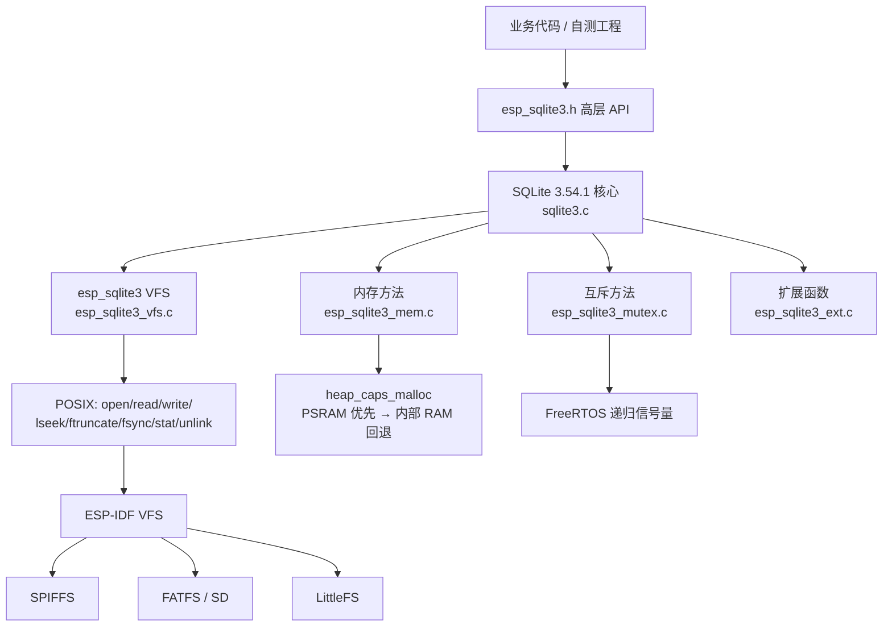
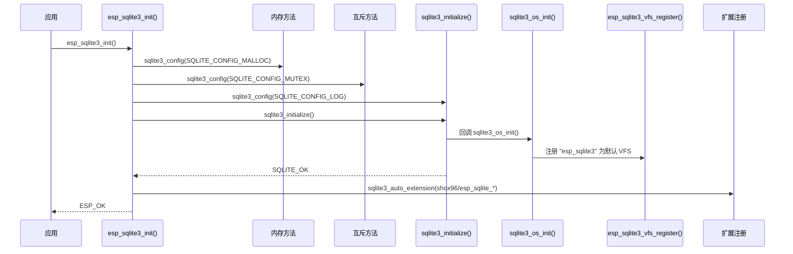

# esp_sqlite3 架构设计

> 组件位置：`FmC5Demo/components/esp_sqlite3`
> 适用：ESP-IDF v5.x ~ v6.x（v5.5.4 / v6.1 已验证编译）
> 数据库内核：SQLite 官方 3.54.1 amalgamation（未修改）

## 1. 设计目标

1. **官方内核**：`sqlite3.c/h/ext.h` 直接来自 sqlite.org，保持原样，只通过编译宏裁剪。
2. **真正的可靠性**：文件锁、回滚日志、fsync、ftruncate、WAL 共享内存全部按 SQLite VFS 规范实现。
3. **存储无关**：不绑定 SPIFFS/FATFS；只要 ESP-IDF VFS 挂载点支持 POSIX 文件接口即可。
4. **IDF 5/6 双兼容**：不依赖 `console`、`spi_flash_mmap.h` 等易变组件/头文件。
5. **可裁剪**：MAX / FULL / STANDARD / MINIMAL / CRUD 五档，
   覆盖“功能上限”到“Flash 优先”。
6. **可观测**：统一日志、SQLite 扩展错误码、错误偏移、VFS/内存统计。
7. **旧版兼容**：保留 `shox96_0_2c/d`，提供 `db_open/db_exec` 风格的简化封装。

非目标：

- 不支持多进程/多核之间的跨进程文件锁（ESP-IDF 是单进程固件，进程内锁已足够）；
- 不支持 mmap（`SQLITE_MAX_MMAP_SIZE=0`，ESP32 无通用文件 mmap）；
- 不支持动态加载 `.so` 扩展（无 dlopen）；
- 不提供 SQL shell（需要可在 PC 上用 `sqlite3` 工具操作导出的 DB 文件）。

## 2. 分层结构



### 2.1 为什么 VFS 走 POSIX，而不是直接调文件系统 API

- SPIFFS / FATFS / LittleFS / SD 都注册到 ESP-IDF VFS，统一暴露 `open/read/write/...`；
- 业务只需要换挂载点，不需要改数据库代码；
- SQLite VFS 只要求这些语义，POSIX 映射最直接；
- 避免直接依赖 `esp_spiffs_*`、`esp_vfs_fat_*` 等具体文件系统头文件。

## 3. 目录与职责

| 文件 | 职责 |
|------|------|
| `sqlite3/sqlite3.c` | 官方 amalgamation，不修改 |
| `src/esp_sqlite3.c` | 生命周期、打开/关闭、PRAGMA 默认值、执行/查询、事务、维护、迁移、错误映射 |
| `src/esp_sqlite3_vfs.c` | VFS 注册、文件锁状态机、日志文件、WAL 共享内存、POSIX 适配、统计 |
| `src/esp_sqlite3_mem.c` | `sqlite3_mem_methods`：PSRAM 优先、阈值、回退、size/roundup |
| `src/esp_sqlite3_mutex.c` | `sqlite3_mutex_methods`：FreeRTOS 递归信号量、静态/动态互斥量 |
| `src/esp_sqlite3_ext.c` | shox96 压缩/解压、`esp_sqlite_version/esp_sqlite_uptime_ms/esp_sqlite_random/esp_sqlite_mem_used` |
| `src/esp_sqlite3_selftest.c` | 可选自测（`CONFIG_ESP_SQLITE3_SELFTEST`） |
| `src/esp_sqlite3_force_ndebug.h` | IDF5 `assert` 求值兼容（只对 sqlite3.c 强制包含） |
| `include/esp_sqlite3.h` | 高层 API（中文注释） |
| `include/esp_sqlite3_vfs.h` | VFS 注册、统计、路径工具 |

## 4. 初始化时序



关键顺序：

1. **MALLOC / MUTEX / LOG 必须在 `sqlite3_initialize()` 之前配置**；
2. VFS 在 `sqlite3_os_init()` 中注册，`SQLITE_OS_OTHER=1` 时由 SQLite 自动回调；
3. 扩展在初始化完成后通过 `sqlite3_auto_extension()` 注册，对之后打开的连接生效；
4. 不要在 `esp_sqlite3_init()` 之前调用任何 `sqlite3_*` API，否则自定义分配器/互斥量无法生效。

## 5. VFS 设计

### 5.1 文件对象

`esp_sqlite3_vfs_file` 继承 `sqlite3_file`，额外保存：

- `fd`：ESP-IDF VFS 文件描述符；
- `path`：规范化后的绝对路径（用于锁表、临时文件、HAS_MOVED）；
- `lock`：共享的文件锁状态；
- `shm`：WAL 共享内存；
- `delete_on_close`：临时文件/日志在关闭后删除；
- `lock_level`：当前 SQLite 锁级别。

`sqlite3_vfs.szOsFile = sizeof(esp_sqlite3_vfs_file)`，`mxPathname = CONFIG_ESP_SQLITE3_MAX_PATH`。

### 5.2 路径规则

| 输入 | 处理 |
|------|------|
| `/spiffs/app.db` | 原样使用 |
| `app.db` | 拼成 `CONFIG_ESP_SQLITE3_DEFAULT_DIR/app.db` |
| `:memory:` | SQLite 内部处理，不进入 VFS |
| 空路径（临时库） | 生成 `CONFIG_ESP_SQLITE3_TEMP_DIR/esp_sqlite_tmp_xxxxxxxxxxxxxxxx` |

### 5.3 文件锁状态机

SQLite 的锁级别：

```text
NONE(0) → SHARED(1) → RESERVED(2) → PENDING(3) → EXCLUSIVE(4)
```

实现要点：

| 操作 | 规则 |
|------|------|
| SHARED | 没有 EXCLUSIVE，且没有其他连接的 PENDING；`n_shared++` |
| RESERVED | 本连接已持 SHARED；且没有其他 RESERVED |
| PENDING | 本连接已持 RESERVED；且没有其他 PENDING/RESERVED |
| EXCLUSIVE | 本连接至少持 SHARED；`n_shared == 1`；没有其他 EXCLUSIVE/RESERVED |
| UNLOCK | 逐级释放；降到 NONE 时 `n_shared--` |
| CheckReservedLock | 只有**其他文件对象**持有 RESERVED 才返回 1（POSIX 语义） |

冲突时返回 `SQLITE_BUSY`，由 SQLite 的 `busy_timeout` 重试；VFS 不内部阻塞，
避免长时间占用调用任务。

锁表以规范化路径为 key，多个连接打开同一个 DB 时共享同一个 `esp_sqlite3_vfs_lock`。

### 5.4 回滚日志（journal）

- journal 是**真实文件**（`db.sqlite-journal`），不是 RAM 链表；
- 打开时按 SQLite 传入的 `SQLITE_OPEN_DELETEONCLOSE` 记录 `delete_on_close`；
- `xClose` 时先关闭 fd，再 `unlink`（避免部分文件系统“打开中不能删除”）；
- 崩溃/掉电后 journal 仍在 Flash 上，SQLite 下次打开时会回滚未提交事务；
- `PRAGMA journal_mode=TRUNCATE/PERSIST` 由 SQLite 自己调用 `xTruncate`/`xSync` 实现。

### 5.5 WAL 与共享内存

WAL 模式需要：

- `xShmMap`：分配/返回 WAL-index 页面；
- `xShmLock`：8 个锁槽（WRITE/CKPT/RECOVER + 5 个 READ）；
- `xShmBarrier`：内存屏障；
- `xShmUnmap`：释放。

实现方式：

- WAL-index 放在**进程内堆内存**（优先 PSRAM），不创建真实的 `-shm` 文件；
- 以数据库路径为 key 维护 `esp_sqlite3_vfs_shm`，多个连接共享同一份区域；
- `xShmLock` 用“独占持有者指针 + 共享计数”实现，冲突返回 `SQLITE_BUSY`；
- `-wal` 文件本身仍是真实文件，由 SQLite 正常读写/删除。

> 注意：WAL 在 SPIFFS 上会额外产生 `-wal` 写入；长期高频写入设备建议
> `journal_mode=DELETE` 或定期 `wal_checkpoint(TRUNCATE)` + `VACUUM`。

### 5.6 同步、截断、扇区

| 方法 | 实现 |
|------|------|
| `xSync` | `fsync(fd)`；`SQLITE_NO_SYNC` 可关闭；`ENOSYS/EINVAL` 视为成功 |
| `xTruncate` | `ftruncate(fd, size)`；失败返回 `SQLITE_IOERR_TRUNCATE` |
| `xFileSize` | `fstat(fd).st_size` |
| `xSectorSize` | `CONFIG_ESP_SQLITE3_SECTOR_SIZE`（默认 4096） |
| `xDeviceCharacteristics` | 默认 0；可选 `SQLITE_IOCAP_POWERSAFE_OVERWRITE`（默认关闭） |

### 5.7 文件控制

| `SQLITE_FCNTL_*` | 行为 |
|------------------|------|
| `SIZE_HINT` / `CHUNK_SIZE` | 返回 OK，不预分配（避免 SPIFFS 立刻占空间） |
| `PERSIST_WAL` | 记录标志 |
| `TEMPFILENAME` | 生成临时文件绝对路径，`sqlite3_mprintf` 返回 |
| `VFSNAME` | 返回 `"esp_sqlite3"` |
| `HAS_MOVED` | 检查路径是否还存在 |
| `LOCK_TIMEOUT` | 返回 NOTFOUND，交给 busy handler |
| 其他 | 返回 NOTFOUND |

## 6. 内存模型

### 6.1 自定义分配器

`esp_sqlite3_mem.c` 通过 `sqlite3_config(SQLITE_CONFIG_MALLOC)` 注册：

- 小于 256 字节：内部 RAM（访问快）；
- ≥256 字节：优先 `heap_caps_malloc(MALLOC_CAP_SPIRAM)`；
- PSRAM 不足/未启用：自动回退内部 RAM；
- `xSize` 使用 `heap_caps_get_allocated_size()`；
- `xRoundup` 按 8 字节对齐。

未使用 `SQLITE_MALLOC` 宏覆盖，因为 `sqlite3.c` 内部会无条件定义该宏；
官方推荐的运行期 `SQLITE_CONFIG_MALLOC` 更安全，也便于统计。

### 6.2 默认内存参数

| 参数 | 默认 | 说明 |
|------|------|------|
| 页大小 | 4096 | 适配 Flash 文件系统 |
| 页缓存 | 64 KiB/连接 | `SQLITE_DEFAULT_CACHE_SIZE=-64` |
| Lookaside | 32 × 256B = 8 KiB/连接 | 可用 Kconfig 关闭 |
| 临时数据 | 内存（`SQLITE_TEMP_STORE=3`） | 避免写 Flash |
| mmap | 关闭 | ESP32 无通用文件 mmap |
| busy timeout | 5000ms | 可在配置中改 |

## 7. 线程与并发

- 默认 `SQLITE_THREADSAFE=1`（串行化模式）；
- `sqlite3_mutex_methods` 用 FreeRTOS 递归信号量实现：
  - 静态互斥量在 `xMutexInit` 中一次性创建（ID 2..13）；
  - 动态互斥量用 SQLite 分配器（可进 PSRAM）；
  - `xMutexHeld/NotHeld` 通过 `xSemaphoreGetMutexHolder` 判断；
- 同一个连接可以被多个任务“轮流”使用，但同一个 `sqlite3_stmt` 不要并发使用；
- 需要并发读写时，为每个任务 `esp_sqlite3_open()` 独立连接，VFS 文件锁保证一致性；
- VFS 自身的锁表/共享内存表用一把静态递归互斥量保护。

## 8. 可靠性设计

### 8.1 掉电安全链

```text
事务提交
  → 写 journal（真实文件）
  → xSync(journal)         // fsync
  → 写主库
  → xSync(main)            // fsync
  → 删除/截断 journal
```

任何一步掉电：

- journal 完整：下次打开自动回滚；
- journal 不完整：SQLite 根据 journal 头部的校验判断，忽略不完整日志；
- 主库写入中断：journal 仍在，回滚到事务前状态。

前提：文件系统本身不能把“写一半的扇区”报告为成功。SPIFFS/FATFS 一般
不承诺扇区原子性，因此建议：

- `PRAGMA synchronous=FULL`（默认）；
- 不要开启 `SQLITE_NO_SYNC`；
- 不要声明 `SQLITE_IOCAP_POWERSAFE_OVERWRITE`（除非确认硬件/FS 支持）。

### 8.2 已知限制

- 进程内锁：如果同一 Flash 被两个进程/两个核上的两套 SQLite 同时访问（例如
  双核各自链接一份），文件锁不跨进程；ESP-IDF 常规固件是单进程，不受影响；
- WAL 的 `-shm` 是内存态，系统复位后由 SQLite 重新构建；
- SPIFFS 长时间随机写会磨损，建议只存配置/离线队列，并定期清理；
- `VACUUM` 需要额外空间（约等于数据库大小），空间不足会失败；
- 大结果集排序受 `cache_size` 和可用堆限制，超出会报 `SQLITE_FULL/NOMEM`。

### 8.3 Flash 磨损与均衡擦写

SQLite **不实现**均衡擦写；它只负责页读写、日志、WAL 和 B-tree 更新。
磨损均衡由底层文件系统/驱动负责，本组件通过 ESP-IDF VFS 访问文件，
因此继承底层文件系统的能力：

| 存储方案 | 均衡擦写 | 说明 |
|----------|----------|------|
| SPIFFS | ✅ 内建 | 自测工程默认使用；具备磨损均衡 |
| FATFS + wear_levelling | ✅ | 必须用 `esp_vfs_fat_spiflash_mount_rw_wl` 等带 WL 的挂载方式 |
| FATFS 直接挂 raw Flash | ❌ | 无 WL，频繁写会快速磨损，不推荐 |
| LittleFS | ✅ 内建 | 需自行加入组件并挂载 |
| SD 卡 | ✅ 卡内控制器负责 | 对 ESP32 透明，但仍有写寿命 |

数据库侧会放大擦写的操作：

- 逐条自动提交：每条都写 journal + fsync；
- WAL：额外写 `-wal` 文件；
- 页更新：重写整页（默认 4096B）；
- `VACUUM`：重写整个数据库；
- `secure_delete=ON`：删除内容清零；
- `auto_vacuum`：移动页；
- 高频 `ANALYZE` / `PRAGMA optimize`：写统计表。

降低磨损的建议：批量事务、预编译复用、定期清理历史数据、避免频繁
`VACUUM`、默认关闭 `secure_delete`、选择带 WL 的文件系统；长期运行设备
建议 `journal_mode=DELETE` 或 WAL + 定期 `wal_checkpoint(TRUNCATE)`。

## 9. 安全设计

- `PRAGMA foreign_keys=ON` 默认开启；
- 可配置 `SQLITE_DBCONFIG_DEFENSIVE`，禁止写系统表和危险 PRAGMA；
- 可配置 `PRAGMA query_only=ON` 用于只读连接；
- 所有拼接 SQL 的封装（`VACUUM INTO`）使用 `sqlite3_mprintf("%Q")` 转义；
- 业务层仍应使用预编译语句绑定参数，避免 SQL 注入；
- `SQLITE_SECURE_DELETE` 默认关闭（省 Flash 擦写），需要防恢复时再开；
- `PRAGMA trusted_schema` 默认保持 SQLite 默认值；对不可信 DB 文件可手动设为 OFF。

## 10. Flash 预算与分区

### 10.1 为什么必须改分区

| 项目 | 大小 |
|------|------|
| 当前主固件 | ≈1536KB |
| MAX 组件（静态库） | ≈587KB |
| 主固件 + MAX | ≈2123KB |
| 主固件 + FULL | ≈2106KB |
| 主固件 + CRUD | ≈1904KB |
| 现有 app 分区 | 1792KB |

即使 CRUD 档位（≈368KB）也放不下。当前 Flash 实际是 **16MB**，但
`partitions.csv` 仍是 4MB 布局，浪费了 12MB。

### 10.2 推荐布局

> **建议使用 8MB 及以上 Flash**。4MB 布局只适合独立小固件/自测工程；
> 主固件 + SQLite 建议从 8MB 起步，16MB 更宽裕。

#### 8MB Flash

见 [`partitions/partitions_8mb_sqlite.csv`](../partitions/partitions_8mb_sqlite.csv)：

| 分区 | 偏移 | 大小 |
|------|------|------|
| nvs | 0x9000 | 16KB |
| otadata | 0xD000 | 8KB |
| phy_init | 0xF000 | 4KB |
| ota_0 | 0x10000 | 2.5MB |
| ota_1 | 0x290000 | 2.5MB |
| storage (SPIFFS) | 0x510000 | 约 2.9MB |

#### 16MB Flash

见 [`partitions/partitions_16mb_sqlite.csv`](../partitions/partitions_16mb_sqlite.csv)：

| 分区 | 偏移 | 大小 |
|------|------|------|
| nvs | 0x9000 | 16KB |
| otadata | 0xD000 | 8KB |
| phy_init | 0xF000 | 4KB |
| ota_0 | 0x10000 | 4MB |
| ota_1 | 0x410000 | 4MB |
| storage (SPIFFS) | 0x810000 | 4MB |

切换步骤：

1. 备份设备 NVS（可选）；
2. 按 Flash 容量选择 `partitions_8mb_sqlite.csv` 或
   `partitions_16mb_sqlite.csv`，把内容复制到 `partitions.csv`；
3. `idf.py erase-flash flash`（**必须 USB 全片烧录**）；
4. 之后 OTA 可继续使用。

> 分区表偏移变化后，旧固件 OTA 到新布局会写错位置，因此**不能只发 OTA**。
> 这是本方案没有直接替换主工程 `partitions.csv` 的原因。

### 10.3 文件系统选择

| 文件系统 | 优点 | 缺点 | 建议 |
|----------|------|------|------|
| SPIFFS | IDF 内置、磨损均衡、小分区简单 | 随机写慢、目录能力弱 | 配置/离线队列，小 DB |
| FATFS | 性能较好、PC 可读、工具多 | 掉电一致性一般、磨损均衡依赖 WL | SD 卡/较大 DB |
| LittleFS | 掉电一致性较好、磨损均衡 | 需要额外组件 | 推荐用于频繁写 |
| SD 卡 | 容量大、PC 可读 | 掉电/拔卡风险 | 日志/导出，不作为唯一存储 |

## 11. 升级 SQLite 内核

1. 从 https://sqlite.org/download.html 下载新的 amalgamation；
2. 校验 SHA3-256；
3. 替换 `components/esp_sqlite3/sqlite3/sqlite3.c/h/ext.h`；
4. 检查新增/删除的编译选项（`sqlite3_compileoption_get` 或官方 changelog）；
5. 跑 `test_apps/selftest`；
6. 若出现 `assert` 相关编译错误，确认 `esp_sqlite3_force_ndebug.h` 仍生效；
7. 更新 `ESP_SQLITE3_VERSION_STRING` 与文档中的版本号。

## 12. 关键设计取舍

| 取舍 | 选择 | 原因 |
|------|------|------|
| 官方 amalgamation vs 社区魔改 | 官方 | 可维护、可升级、安全修复 |
| POSIX VFS vs 直接文件系统 API | POSIX | 存储无关、代码清晰 |
| 日志落盘 vs RAM | 落盘 | 掉电可恢复 |
| WAL 默认开 vs 关 | FULL/STANDARD/MAX 开 | 性能/并发更好；MINIMAL/CRUD 关 |
| 页大小 512 vs 4096 | 4096 | Flash 友好、减少写放大 |
| 临时数据内存 vs 文件 | 内存 | 省擦写、速度快 |
| 线程安全 vs 体积 | 默认开 | 业务常见多任务；可 Kconfig 关闭 |
| 共享缓存 | 固定移除 | 官方已废弃（`SQLITE_OMIT_SHARED_CACHE`） |
| 废弃 API | 固定移除 | 官方已废弃（`SQLITE_OMIT_DEPRECATED`） |
